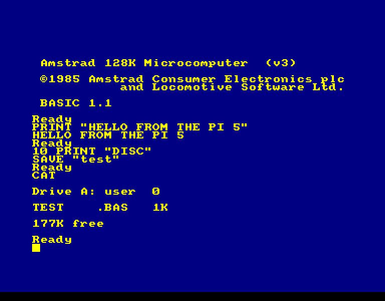
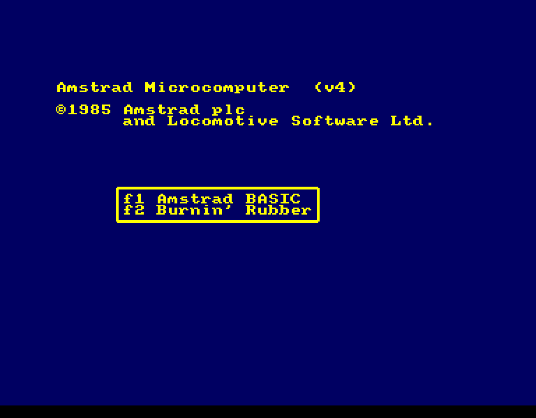
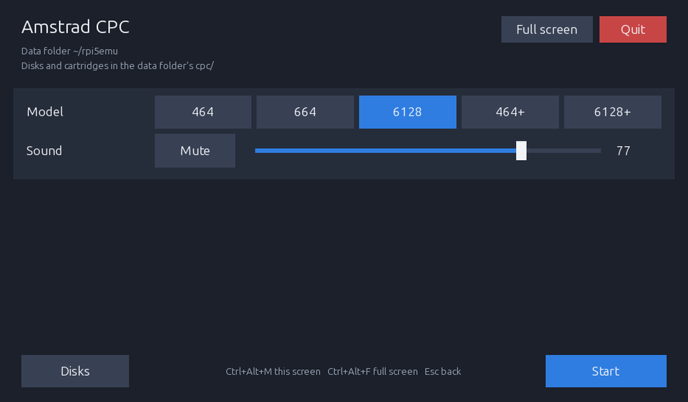
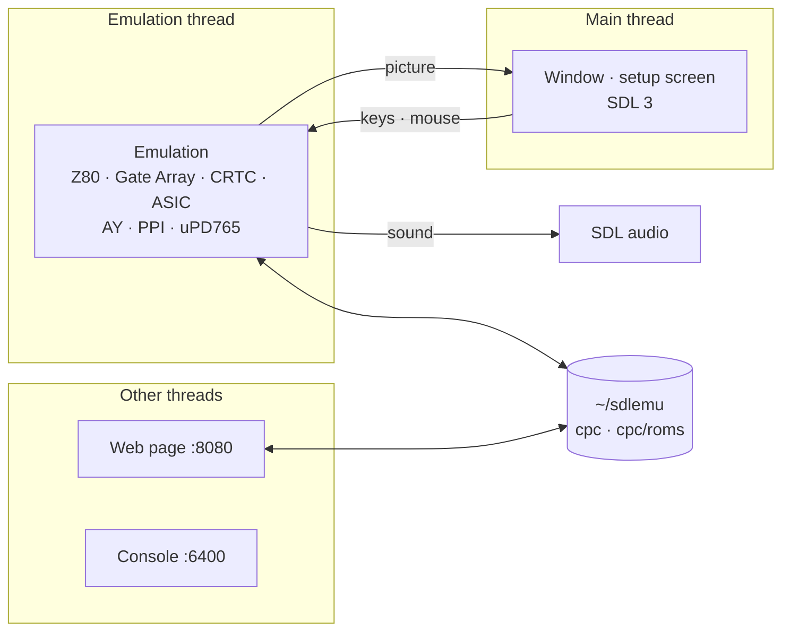

<h1 align="center">sdlcpc</h1>

<p align="center">
  <b>An Amstrad CPC 464, 664, 6128, 464 Plus or 6128 Plus in an SDL 3 window on Linux or macOS.</b><br>
  Z80 with the real CPC timing, Plus hardware sprites and 4096 colours, disks, cartridges.
</p>

<p align="center">
  
  
  
  
  
  
</p>

<p align="center">
  <b>Work in progress:</b> not everything has been tested, and games and demos may or may not
  work satisfactorily.
</p>

<p align="center">
  
  
  <br>
  <sub>The CPC 6128 with a program saved to a new disc and catalogued, and the 6128 Plus's system cartridge menu, on the Pi.</sub>
</p>

sdlcpc runs [esp32cpc](https://github.com/rlucencic/esp32cpc)'s CPC on 64-bit Linux (arm64 and amd64) and Apple Silicon macOS. SDL 3 provides the window, sound and input. The machine is the
same code as on the ESP32 boards: esp32cpc's platform-independent core and
[esp32emu](https://github.com/rlucencic/esp32emu)'s CPU core, on
[sdlemu](https://github.com/rlucencic/sdlemu), the family's desktop runtime: a setup
screen in the window, sound, the host's keyboard and mouse, a web page on your network and a
console.

It belongs to the SDL desktop family of the ESP32 emulators:
[sdlzx](https://github.com/rlucencic/sdlzx) (ZX Spectrum),
[sdlcbm](https://github.com/rlucencic/sdlcbm) (Commodore 64 and 128),
[sdlcoco](https://github.com/rlucencic/sdlcoco) (Tandy Color Computer 2 and 3),
[sdlgs](https://github.com/rlucencic/sdlgs) (Apple IIGS),
[sdlmsx](https://github.com/rlucencic/sdlmsx) (MSX1 and MSX2),
[sdlxl](https://github.com/rlucencic/sdlxl) (Atari 800XL and 130XE),
[sdlste](https://github.com/rlucencic/sdlste) (Atari STE),
[sdlpc](https://github.com/rlucencic/sdlpc) (IBM PC/XT and PC/AT),
[sdlmac](https://github.com/rlucencic/sdlmac) (Macintosh Plus, SE, Classic),
[sdlmac2](https://github.com/rlucencic/sdlmac2) (Macintosh LC and II),
[sdlmac3](https://github.com/rlucencic/sdlmac3) (Macintosh LC II and LC III),
[sdlarc](https://github.com/rlucencic/sdlarc) (Acorn Archimedes),
[sdlami](https://github.com/rlucencic/sdlami) (Amiga 500, 2000, 600, 1200).

## Features

**The machine**
- **Five models**, chosen on the setup screen: CPC 464, 664 and 6128, and
  the 464 Plus and 6128 Plus, each with its own RAM (64 KB; 128 KB on the 6128s)
- Locomotive BASIC, AMSDOS, CP/M 2.2 and CP/M Plus from the original disks
- Z80 that passes zexall, timed like the CPC's: the Gate Array stretches every
  instruction to whole microseconds, and I/O happens at the right microsecond
  inside it, so raster effects land where they should
- 6845 CRTC as counters (split screens, overscan, rupture tricks), Gate Array
  with mid-line colour and mode changes, interrupts every 52 lines
- AY-3-8912 sound (A left, C right, B in the middle) and the keyboard matrix
- **Plus ASIC**: 4096 colours, 16 hardware sprites with magnification,
  split screen, soft scroll, programmable raster interrupt, three DMA sound
  channels, IM 2 vectors; unlocked by the usual sequence

**Disks and cartridges**
- Drives **A:** and **B:** for `.dsk` images (standard and extended DSK,
  including weak sectors and sector status for protected disks); the 464 gets
  a disc drive too, like a DD1
- **New blank disks**, formatted (data or system format), ready for `SAVE`
- **Cartridge slot**: Plus cartridges (`.cpr`), or expansion ROMs (`.rom`,
  with or without an AMSDOS header) in the upper ROM slots, like a ROM board.
  Games converted to ROMs come in parts (`NAME_1.ROM`, `NAME_2.ROM`):
  inserting the first brings the others along; start them with `|NAME`
- Disk writes go back to the data folder a second after they happen

**Around it**
- **A window** of its own on the Pi's desktop (X11 or Wayland), resizable, full screen
  with Ctrl+Alt+F; the picture in the machine's shape, sharp pixels
- **Setup screen** in the window, first thing at start and any time with Ctrl+Alt+M:
  model, the sound's volume, the drives and their images (insert, eject, new
  blank ones), Start / Back / Restart, Reset
- **The Pi's keyboard and mouse**: keys by position, as the boards' Bluetooth keyboards;
  a click in the window gives the mouse to the machine, Ctrl+Alt+G takes it back
- **Web page** at `http://<the Pi>:8080/`: drop images (or ZIP files) onto it, insert
  them, make blank ones, and watch the machine and its drives live
- **Sound** through SDL (PipeWire, PulseAudio or ALSA), the machine paced by the clock
- **Console** on the terminal and on `127.0.0.1:6400`: keys, typing, drives, screenshots

<p align="center">
  
  <br><sub>The setup screen in the window, before the CPC starts</sub>
</p>

## Getting started

### 1. What you need

- 64-bit Linux (including Raspberry Pi 5) or Apple Silicon macOS with SDL 3.2 or newer. See [desktop build dependencies](https://github.com/rlucencic/sdlemu#building).
- [esp32emu](https://github.com/rlucencic/esp32emu), [sdlemu](https://github.com/rlucencic/sdlemu)
  and [esp32cpc](https://github.com/rlucencic/esp32cpc), cloned next to this project
- The ROMs (below)

### 2. Build

```sh
git clone https://github.com/rlucencic/esp32emu.git
git clone https://github.com/rlucencic/sdlemu.git
git clone https://github.com/rlucencic/esp32cpc.git
git clone https://github.com/rlucencic/sdlcpc.git && cd sdlcpc
cmake -S . -B build -G Ninja && cmake --build build
```

### 3. ROMs

In the data folder's `cpc/roms/` (`~/sdlemu/cpc/roms`), named as esp32cpc's:
`os464.rom`, `basic10.rom`, `os664.rom`, `basic664.rom`, `os6128.rom`,
`basic11.rom`, `amsdos.rom` (16 KB each); for the Plus `system.cpr`, or
`osplus.rom` and `basicplus.rom`. Not part of this repository.

### 4. First start

1. `build/sdlcpc`: the setup screen opens in a window.
2. Choose the model and click **Start**.
3. Put images into `~/sdlemu/cpc/`, drop them on the window or the web page, and
   insert them on the setup screen's **Disks** page.

## Using it

| To | Do |
|---|---|
| Get back to the setup screen | Ctrl+Alt+M (the machine waits meanwhile) |
| Full screen | Ctrl+Alt+F |
| Give the mouse to the machine, take it back | A click in the window; Ctrl+Alt+G |
| Run as fast as it goes (warp) | Ctrl+Alt+W, again for real speed |
| Take a screenshot | Ctrl+Alt+S (into `~/sdlemu/screenshots`), or the console's `s` |
| Insert an image | The setup screen's **Disks** page, drop it on the window or the web page, or name it on the command line: `build/sdlcpc game.dsk` |
| Start straight into the machine | `build/sdlcpc -S`, with the setup screen's rows as `--choice`: `build/sdlcpc -S --choice Model=6128` |
| Show the window on another computer | Log in with `ssh -C -Y <the Pi>` and start it there: fine for still pictures; games want the Pi's own monitor |
| Catalogue and run | `CAT`, then `RUN"NAME` (CP/M: `|CPM` with a CP/M system disk) |
| Play a Plus cartridge | Insert the `.cpr` into **Cartridge** on a 464 Plus or 6128 Plus: the Plus restarts from it |
| Use expansion ROMs | Insert the `.rom` into **Cartridge**: the CPC restarts with it in slot 1 (2, 3 ... for more parts); then `|NAME` |

Images live in `~/sdlemu/cpc/`, settings in `~/.config/sdlemu/settings.ini`; the
inserted images are remembered across starts. `build/sdlcpc --help` lists the options.

**Keyboard**: keys by position, a UK CPC keyboard on a PC keyboard. F1–F10
are the CPC's f1–f0 keypad keys and F11 its `.`; keypad Enter is ENTER,
Insert is COPY, Delete is CLR, Backspace is DEL, Alt is COPY.

**Joystick**: the numeric keypad (8 4 6 2 and the diagonals, 5 or 0 fire,
`.` second fire). F12 makes the cursor keys the joystick as well, with Alt
as fire; F12 again gives them back.

## How it works



- **[esp32cpc](https://github.com/rlucencic/esp32cpc)'s `components/cpc`**: the CPC,
  platform independent: the same code runs on the ESP32 boards.
- **`src/`**: the glue, esp32cpc's `main/main.c` ported: memory, ROMs, settings, keyboard map,
  drives and status.
- **[sdlemu](https://github.com/rlucencic/sdlemu)**: the window, the setup screen, sound,
  input, the web page, the console, the data folder and the settings.
- **[esp32emu](https://github.com/rlucencic/esp32emu)**: the CPU core (Z80).

## Development

```sh
../sdlemu/tools/pi.sh sdlcpc build        # from another computer: sync to the Pi, build there
../sdlemu/tools/pi.sh sdlcpc run          # its window on this computer (ssh -C -Y)
../sdlemu/tools/pi.sh sdlcpc headless     # no window: drive it through the console
../sdlemu/tools/console.sh i 's /tmp/shot.png'
```

`CLAUDE.md` has the details: the layout, how it was ported, the checks; esp32cpc's own
`CLAUDE.md` has the machine's.

## Limitations

- Checked on the Pi through its console and screenshots: the 6128 at full speed, BASIC, a program saved to a new disc and CAT; the 6128 Plus's cartridge menu. Not yet by hand
  in the window, with the sound heard, or with much software.
- Over X forwarding (`ssh -Y`) every changed picture crosses the network: 8 to 15 a second.
- No cassette (tapes as `.cdt`/`.wav`), printer, or serial interfaces.
- One CRTC behaviour for all models (no type 0/1/2 quirks); demos that rely
  on a particular CRTC type may look different.
- The floppy controller has no rotation timing: protections that measure it
  fail.
- Plus: no analogue joysticks or light gun; sprites only over the screen
  area, not the border.

## Credits

- [Caprice32](https://github.com/ColinPitrat/caprice32), the Arnold V
  specification, [MAME](https://github.com/mamedev/mame) and
  [konCePCja](https://github.com/ikari-pl/konCePCja): the references for
  how the CPC, the Plus ASIC and the Symbiface II behave
- The zexdoc/zexall Z80 exercisers by Frank Cringle
- [SDL](https://libsdl.org) 3 for the window, the sound and the input

## Licence

[MIT](LICENSE).

Amstrad and CPC are trademarks of their owners. The ROM images are not part
of this repository.
